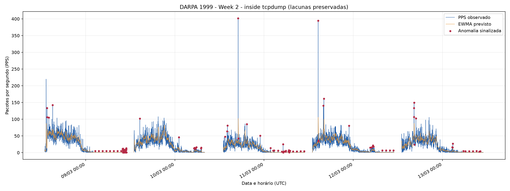
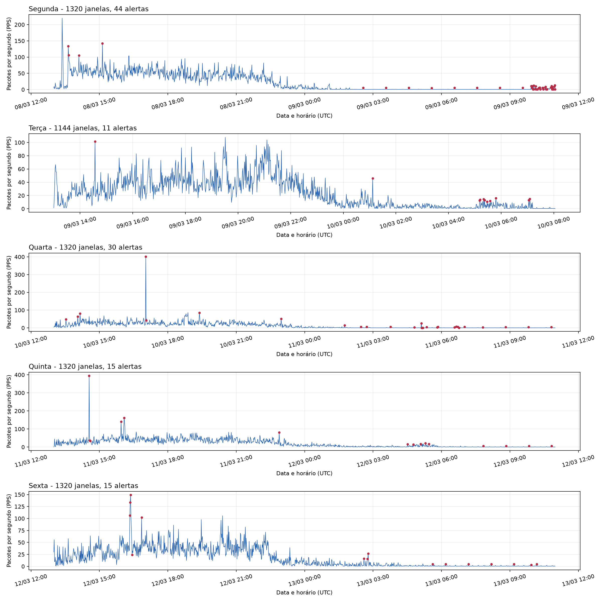
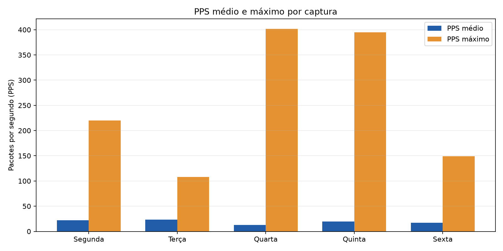
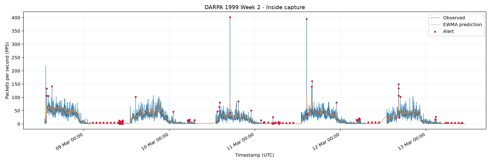

# Etapa 2 — Pré-processamento e detecção offline (DARPA 1999 Week 2)

> **Status: processamento real concluído.** Os arquivos de resultados e imagens
> versionados ficam nesta pasta. Valores aqui são provenientes dos logs,
> de metrics.json e capture_validation.json da execução GitHub Actions abaixo.
> São resultados de um detector de anomalias de PPS, não uma avaliação de
> ataques confirmados.

## Proveniência e ambiente

- Fonte: MIT Lincoln Laboratory, DARPA 1999 Training Week 2, cinco arquivos
  inside.tcpdump.gz (segunda a sexta, 8–12/03/1999).
- Execução: [GitHub Actions #38824820433](https://github.com/dreyvinixz/Anomaly_Detection/actions/runs/38824820433),
  concluída em 15/10/2026, com status success.
- Artifact: darpa-week2-60s-38824820433, ID 12015096756;
  [link oficial do artifact](https://github.com/dreyvinixz/Anomaly_Detection/actions/runs/38824820433/artifacts/12015096756)
  (retido até 29/10/2026 no Actions, conforme configuração daquela execução).
- Código executado no commit 996976b12355d3a41c2fedc19559d6f6c833360a,
  branch feat/mvp-60s-ewma.
- Ambiente: runner GitHub Actions ubuntu-24.04, Python 3.11, TShark e gzip.
- Oito testes unitários sintéticos passaram no job.
- Os cinco arquivos gzip passaram por gzip -t. Seus hashes SHA-256 estão em
  [source_archive_sha256sums.txt](results/source_archive_sha256sums.txt).
- Os PCAPs compactados não foram versionados. O CSV processado e os demais
  resultados estão no próprio Git para permanecer acessíveis após o vencimento
  do Artifact.

## Pré-processamento e validação

A leitura ocorreu em streaming, usando gzip -dc e tshark -r - com os campos
frame.time_epoch e frame.len. Cada pacote foi atribuído à janela alinhada ao
início do minuto UTC:

- início_da_janela = floor(timestamp_epoch / 60) * 60
- PPS = quantidade_de_pacotes_da_janela / 60
- bytes/s = soma_de_frame.len_na_janela / 60

O arquivo [traffic_60s.csv](data/traffic_60s.csv) contém source_day,
window_start_utc, packets, bytes_total, pps e bytes_per_second. O validador
verificou cinco capturas, janelas alinhadas em 60s, ordem cronológica e
consistência entre contagens e taxas. Os horários em UTC também são apresentados
convertidos para America/New_York em
[capture_validation.json](results/capture_validation.json). Isso ainda não
substitui a verificação do fuso dos rótulos oficiais de ataques.

### Contagens e estatísticas por captura

| Captura | Pacotes | Janelas de 60 s | PPS médio | PPS máximo | Alertas | Janelas avaliadas |
|---|---:|---:|---:|---:|---:|---:|
| Segunda | 1.753.377 | 1.320 | 22,1386 | 219,9333 | 44 | 1.290 |
| Terça | 1.585.120 | 1.144 | 23,0932 | 107,7500 | 11 | 1.114 |
| Quarta | 1.011.149 | 1.320 | 12,7670 | 401,7167 | 30 | 1.290 |
| Quinta | 1.563.069 | 1.320 | 19,7357 | 394,7833 | 15 | 1.290 |
| Sexta | 1.362.422 | 1.320 | 17,2023 | 149,1833 | 15 | 1.290 |
| **Total** | **7.275.137** | **6.424** | **18,8749** | **401,7167** | **115** | **6.274** |

O PPS médio global é uma média ponderada pelas janelas observadas, não a média
simples dos cinco valores diários.

**Lacunas:** a auditoria encontrou quatro interrupções entre janelas
observadas, somando 656 minutos sem janela no CSV (120 + 296 + 120 + 120).
A coleta de terça-feira termina mais cedo, por isso tem 1.144 janelas.
Esses minutos ausentes não devem ser interpretados como tráfego igual a zero.
Veja os limites temporais completos no JSON de validação.

## Resultados do detector EWMA + MAD

| Estatística | Resultado |
|---|---:|
| Total de janelas | 6.424 |
| Janelas de aquecimento | 150 (30 por captura) |
| Janelas pontuadas | 6.274 |
| Alertas de anomalia | 115 |
| Taxa de alertas entre as janelas pontuadas | 1,8330% |
| PPS médio | 18,8749 |
| PPS mediano | 8,5250 |
| PPS máximo | 401,7167 |
| MAE do preditor | 6,1314 PPS |
| RMSE do preditor | 12,3259 PPS |

Parâmetros: alpha=0.2, threshold=4.5, warmup=30, history=120,
scale_floor=0.5 PPS e reset_gap_minutes=5. Mais detalhes estão
em [metrics.json](results/metrics.json) e
[detections.csv](results/detections.csv).

A maior taxa foi **401,7167 PPS em 10/03/1999 às 17:02 UTC**, na
captura de quarta-feira, e foi sinalizada como anomalia. Um segundo pico
significativo ocorreu na quinta-feira (394,7833 PPS).

**Limitação observada no warmup:** na segunda-feira, em
08/03/1999 às 13:22 UTC, houve um pico de 219,9333 PPS que
**não foi sinalizado**, porque a janela estava no período de
aquecimento, sem histórico suficiente para calcular um score válido.
Isso não deve ser interpretado como um falso negativo confirmado de ataque:
os ataques documentados ainda não foram associados a essas janelas.

## Gráficos reais — eixo Y em pacotes por segundo

### 1. Série semanal corrigida (recomendada)

Esta versão **não conecta** o fim da captura de um dia ao início do próximo
como se houvesse medições durante as interrupções. Mostra PPS observado,
EWMA previsto e janelas sinalizadas.

### 2. Tráfego por dia

### 3. PPS médio e máximo por captura

### 4. Gráfico original da execução

Este gráfico original é preservado para rastreabilidade. **Atenção:** ele
traça linhas entre dados separados por lacunas de captura e pode sugerir
continuidade temporal que não existe. Prefira o gráfico corrigido acima.

## Interpretação científica e limitações

1. **Anomalia != ataque.** As 115 janelas sinalizadas não são 115 ataques
   comprovados. Ainda não foi feito o alinhamento temporal com o ground truth
   do MIT nem uma verificação de visibilidade de cada ataque na captura INSIDE.
2. Sem rótulos corretamente alinhados, **não** reportar precisão, recall,
   F1-score nem taxa de detecção de ataques.
3. O detector usa apenas PPS: ataques de baixa intensidade volumétrica
   podem passar despercebidos, enquanto picos legítimos podem causar alertas.
4. O EWMA continua se adaptando ao tráfego observado durante os alertas,
   podendo atenuar a detecção de ataques prolongados.
5. Dados históricos/simulados do DARPA 1999 não asseguram desempenho em
   tráfego contemporâneo.
6. Evitar ligar graficamente intervalos sem coleta e evitar classificar
   lacunas como janelas de PPS igual a zero.

## Reprodutibilidade e arquivos

- [data/traffic_60s.csv](data/traffic_60s.csv): janelas agregadas a 60 s.
- [results/detections.csv](results/detections.csv): EWMA, resíduo, MAD score,
  warmup e flag de anomalia para cada janela.
- [results/anomalies.csv](results/anomalies.csv): somente janelas sinalizadas.
- [results/metrics.json](results/metrics.json): parâmetros e métricas.
- [results/capture_validation.json](results/capture_validation.json): auditoria
  das cinco capturas e lacunas.
- [results/source_archive_sha256sums.txt](results/source_archive_sha256sums.txt):
  checksums dos arquivos originais comprimidos.
- [figures/](figures/): PNGs originais e corrigidos.

Os arquivos CSV/JSON e o gráfico original foram obtidos diretamente do
artifact da execução #38824820433 por
[.github/workflows/publish-week2-results.yml](../../.github/workflows/publish-week2-results.yml).
Os gráficos adicionais são gerados a partir do CSV versionado por
[scripts/plot_stage2.py](../../scripts/plot_stage2.py), que pode ser executado
novamente com:

~~~bash
python scripts/plot_stage2.py --detections \
  reports/week2-1999/results/detections.csv \
  --figures reports/week2-1999/figures
~~~

A documentação acima integra a **Etapa 2 concluída**. A próxima etapa é
verificar ataques rotulados e testar a qualidade da detecção em função
do tipo de ataque e dos parâmetros do modelo.
