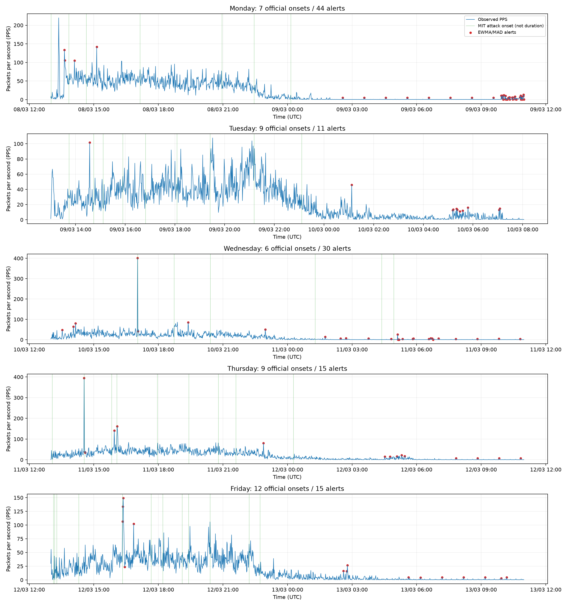
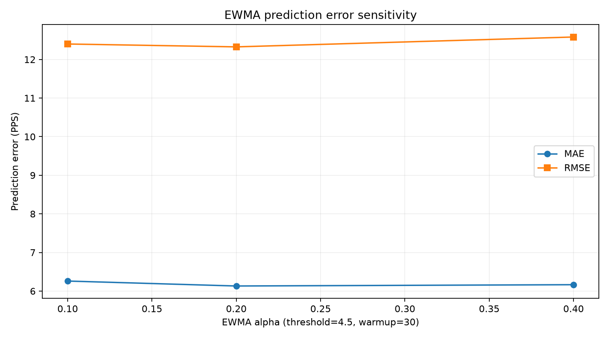
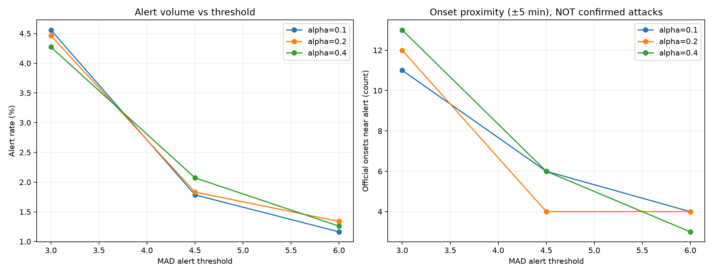

# Etapas 3 e 4 — Ground truth e experimentos (DARPA 1999 Week 2)

## Fonte e interpretação

- **Tabela de ataques**: [MIT Lincoln Laboratory](https://archive.ll.mit.edu/ideval/docs/detections_1999.html) — 43 ataques com data, início, destino e nome. Não informa os limites completos de duração de cada ataque.
- Horário oficial interpretado como America/New_York (EST, UTC−05:00 em março de 1999), verificado contra o início das capturas às 08:00 locais / 13:00 UTC.
- **Detecções e PPS**: [execução reproduzível](https://github.com/dreyvinixz/Anomaly_Detection/actions/runs/38824820433) e reports/week2-1999/results/detections.csv.
- **Matching exploratório**: considera um ataque próximo a um alerta quando o bucket de 60s do alerta ocorre dentro de ±N buckets do bucket contendo o início oficial e pertence à mesma captura diária.
- **Isso NÃO comprova que o alerta detectou aquele ataque**: não verificamos IP de destino ou duração, pois o modelo contém apenas a variável agregada PPS. Múltiplos ataques poderiam coincidir com o mesmo alerta.
- **Não reportamos TP, FP, TN, FN, precision, recall nem F1 definitivos** porque o conjunto disponível tem inícios de ataques, não rotulagem benigno/malicioso completa das 6.424 janelas.

## Cobertura e correspondência temporal

- **Inícios documentados**: 43.
- **Inícios com janela capturada**: 43.
- **Inícios pontuáveis**: 38 (demais estão em warmup ou sem cobertura).
- **Inícios associados a algum alerta em ±5 minutos**: 4 (dos quais 4 com bucket inicial pontuável).
- **Janelas de alerta dentro de ±5 minutos de algum início oficial**: 9.
- **Janelas de alerta fora dessas vizinhanças**: 106 — casos por investigar; **não** são automaticamente falsos positivos.

| Tolerância ± (min) | Inícios próximos de alerta | Inícios pontuáveis próximos | Alertas próximos | Alertas fora da janela |
|---:|---:|---:|---:|---:|
| 0 | 3 | 3 | 3 | 112 |
| 1 | 4 | 4 | 6 | 109 |
| 5 | 4 | 4 | 9 | 106 |
| 10 | 7 | 7 | 13 | 102 |
| 30 | 11 | 11 | 24 | 91 |

## Sensibilidade aos hiperparâmetros

Grid pré-definido: alpha in {0.1, 0.2, 0.4}, MAD threshold in {3.0, 4.5, 6.0}, warmup in {15, 30, 60}; history=120, scale_floor=0.5 PPS, reset_gap_minutes=5.
Todas as configurações usam a **mesma semana**; esta é uma análise descritiva de sensibilidade, não seleção validada em teste independente.

| Alpha | Threshold | Warmup | Alertas | Alert rate (%) | MAE (PPS) | RMSE (PPS) | Onsets próximos (±5 min) |
|---:|---:|---:|---:|---:|---:|---:|---:|
| 0.1 | 3.0 | 15 | 337 | 5.308 | 6.374 | 12.819 | 12 |
| 0.1 | 3.0 | 30 | 286 | 4.559 | 6.260 | 12.400 | 11 |
| 0.1 | 3.0 | 60 | 276 | 4.507 | 6.152 | 12.280 | 11 |
| 0.1 | 4.5 | 15 | 139 | 2.189 | 6.374 | 12.819 | 7 |
| 0.1 | 4.5 | 30 | 112 | 1.785 | 6.260 | 12.400 | 6 |
| 0.1 | 4.5 | 60 | 110 | 1.796 | 6.152 | 12.280 | 6 |
| 0.1 | 6.0 | 15 | 93 | 1.465 | 6.374 | 12.819 | 4 |
| 0.1 | 6.0 | 30 | 73 | 1.163 | 6.260 | 12.400 | 4 |
| 0.1 | 6.0 | 60 | 71 | 1.159 | 6.152 | 12.280 | 4 |
| 0.2 | 3.0 | 15 | 322 | 5.072 | 6.246 | 12.721 | 13 |
| 0.2 | 3.0 | 30 | 280 | 4.463 | 6.131 | 12.326 | 12 |
| 0.2 | 3.0 | 60 | 270 | 4.409 | 6.037 | 12.226 | 12 |
| 0.2 | 4.5 | 15 | 134 | 2.111 | 6.246 | 12.721 | 5 |
| 0.2 | 4.5 | 30 | 115 | 1.833 | 6.131 | 12.326 | 4 |
| 0.2 | 4.5 | 60 | 112 | 1.829 | 6.037 | 12.226 | 4 |
| 0.2 | 6.0 | 15 | 99 | 1.559 | 6.246 | 12.721 | 4 |
| 0.2 | 6.0 | 30 | 84 | 1.339 | 6.131 | 12.326 | 4 |
| 0.2 | 6.0 | 60 | 81 | 1.323 | 6.037 | 12.226 | 4 |
| 0.4 | 3.0 | 15 | 291 | 4.583 | 6.269 | 12.921 | 13 |
| 0.4 | 3.0 | 30 | 268 | 4.272 | 6.165 | 12.581 | 13 |
| 0.4 | 3.0 | 60 | 258 | 4.213 | 6.094 | 12.525 | 12 |
| 0.4 | 4.5 | 15 | 140 | 2.205 | 6.269 | 12.921 | 7 |
| 0.4 | 4.5 | 30 | 130 | 2.072 | 6.165 | 12.581 | 6 |
| 0.4 | 4.5 | 60 | 127 | 2.074 | 6.094 | 12.525 | 6 |
| 0.4 | 6.0 | 15 | 88 | 1.386 | 6.269 | 12.921 | 3 |
| 0.4 | 6.0 | 30 | 79 | 1.259 | 6.165 | 12.581 | 3 |
| 0.4 | 6.0 | 60 | 78 | 1.274 | 6.094 | 12.525 | 3 |

## Gráficos

### Ataques documentados sobre série temporal em PPS

As linhas verticais representam apenas o instante de início oficial, não a duração do ataque.

### Erros de previsão em PPS por alpha

### Sensibilidade do volume de alertas e da proximidade temporal

## Arquivos e reprodutibilidade

- official_attack_onset_matches_5min.csv: os 43 eventos com status de observabilidade e alerta mais próximo;
- alerts_start_proximity_audit.csv: os 115 alertas classificados como próximos ou distantes do INÍCIO oficial (não como TP/FP);
- onset_tolerance.csv: tolerâncias 0/1/5/10/30 minutos;
- hyperparameter_grid.csv: os 27 experimentos completos;
- summary.json: resumo e hashes SHA256 das entradas;
- figures: gráficos PNG; todos os gráficos de tráfego/erro de previsão utilizam PPS no eixo Y.

Execução: python -m anomaly_detection.evaluate_week2 --labels data/ground_truth/darpa1999_week2_official_attack_starts.csv --detections reports/week2-1999/results/detections.csv --series reports/week2-1999/data/traffic_60s.csv --output reports/week2-1999/stage3-4

## Limites e próxima validação

Para classificar um alerta como verdadeiro ou falso positivo, é necessário obter intervalos reais de ataque e verificar tráfego destinado às máquinas oficiais (ou rotulagem pacote/fluxo confiável). Como o detector atual só usa PPS, o matching por horário demonstra proximidade, não causalidade. Não é lícito maximizar F1 usando rótulos de janelas inventados a partir de inícios sem duração.
