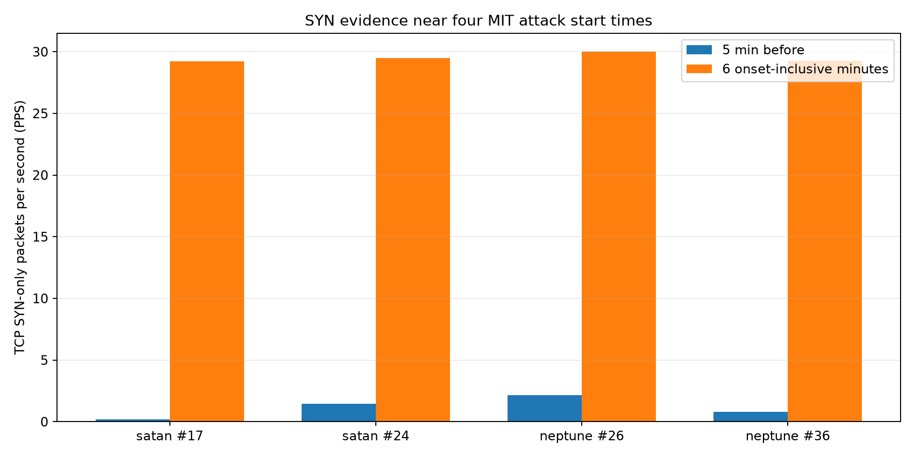
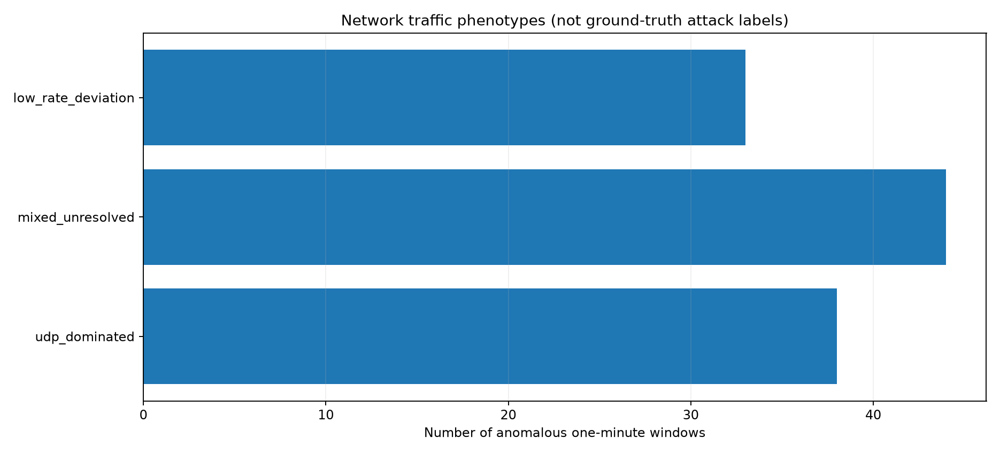

# Etapa 5 — Investigação por destino e protocolo (PCAP INSIDE)

Foram relidas as cinco capturas originais do MIT, com verificação de contagens globais e de cada minuto investigado contra a série da Etapa 2.

| ID | Ataque | Destino oficial | IPv4 oficial | SYN PPS 5 min antes | SYN PPS 6 min a partir do início | Destino SYN mais frequente |
|---:|---|---|---|---:|---:|---|
| 17 | satan | marx.eyrie.af.mil | não resolvido | 0.193333 | 29.227778 | 172.16.114.50 |
| 24 | satan | marx.eyrie.af.mil | não resolvido | 1.466667 | 29.497222 | 172.16.114.50 |
| 26 | neptune | pigeon.eyrie.af.mil | 172.16.114.207 | 2.143333 | 30.002778 | 172.16.114.207 |
| 36 | neptune | marx.eyrie.af.mil | não resolvido | 0.806667 | 29.252778 | 172.16.114.50 |

**Interpretação:** a identificação do IP de pigeon (172.16.114.207) é sustentada pelo inventário oficial de hosts de 1999. O destino marx não aparece naquele inventário e permanece não resolvido; não atribuir ao marx o IP predominante sem provas adicionais.

Os números acima mostram metadados de conexões TCP capturadas nos minutos próximos aos inícios, e não a atribuição de sessões a um ataque. Para saber as contagens relativas ao IP pigeon, consultar four_attack_event_evidence.csv.

## Todos os 115 alertas

Cada janela de alerta foi validada contra o PCAP original e possui contagem TCP/UDP/ICMP, flags SYN/ACK/RST/FIN, número de IPs/portas distintos, principais destinos e fenótipo de tráfego.

| Fenótipo de tráfego | Quantidade de alertas |
|---|---:|
| low_rate_deviation | 33 |
| mixed_unresolved | 44 |
| udp_dominated | 38 |

## Limitações e validade científica

- Os quatro ataques são candidatos temporais, não quatro verdadeiros positivos confirmados.
- Um pico de SYN para um alvo coincide com comportamento suspeito, mas tráfego de fundo também pode contribuir.
- O período analisado (5 min antes, 6 min a partir do início) NÃO representa a duração verificada de cada ataque.
- Os 106 alertas fora de ±5 min dos inícios oficiais não são falsos positivos automaticamente, pois ataques podem continuar.
- Este estudo não identifica integralmente sessões maliciosas, não permite computar TP/FP/F1 definitivos e não deve alegá-los.

## Fontes e reprodutibilidade

- Hosts: https://archive.ll.mit.edu/ideval/docs/hosts_1999.html
- Inícios: https://archive.ll.mit.edu/ideval/docs/detections_1999.html
- Capturas: https://archive.ll.mit.edu/ideval/data/1999/training/week2/index.html
- Código: src/anomaly_detection/packet_evidence.py
- Workflow: .github/workflows/packet-evidence.yml
- Arquivos: packet_window_features.csv, four_attack_event_evidence.csv, all_115_alert_packet_audit.csv, summary.json e dois PNGs.
- Nenhum payload nem PCAP completo foi incluído no Git.
